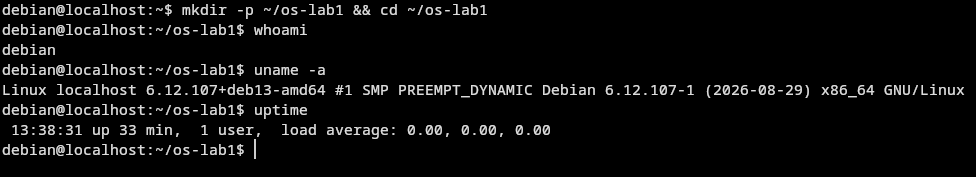
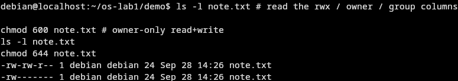
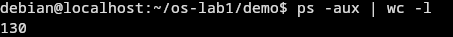
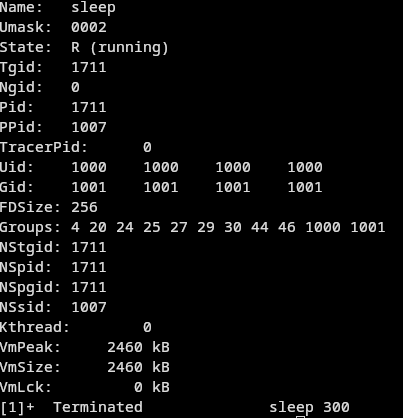
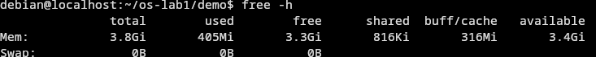
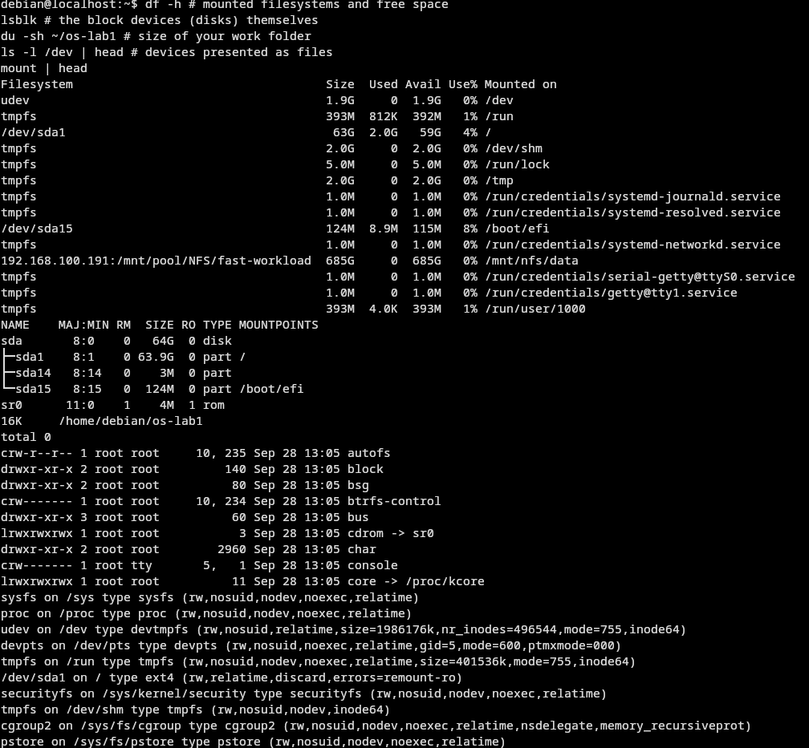

# Report Lab 1-2

# Lab 1

## Before we Start

In the first part of the lab we run some commands. The results are showed in the screenshot below.

### Whoami

This command when run shows you the user that you are logged in with this session.

### Uname

This command prints the kernel build and the version of linux

### Uptime

This command prints out the uptime of the current machine, also shows the cpu load and user sessions that are logged in



## Part 1

### (1) Who owns the files you just created, and which group? 

The file is owned on creation is determined by the file permissions on the parent folder since the files are owned by the user debain group debian the files also expect that



### (2) What do the ten characters at the start of `ls -l` mean for note.txt after chmod 600?

The first characters are decyphered by file-type / user / group / all in triplets except the first one

the numbers are from the bits that holds the this

- r = 4 # Read
- w = 2 # Write
- x = 1 # Execute

and the 600 is just short for to say rw-/---/---


###  (3) Name two directories directly under `/` and say, in one line each, what they hold.


- /tmp holds short time temporary files which are deleted periodically
- /bin holds executable binaries

## Part 2

### (1) What is the PID of process number 1, and what is it (look it up)?

The PID 1 is the first process that is run by the kernel. In linux all of the proccesses are childs of other processes except this one. This special process is run by the kernel on boot and its used to initalize all other programs which your computer may run. On modern systems its usally systemd

### (2) Roughly how many processes were running on your idle VM? 



Its roughly 130

### (3) From /proc/<pid>/status, what does the "State:" line say for your sleeping process?



The state is running

## Part 3


### (1) How much total RAM does the VM have, and how much is free? 

### (2) What is swap, and how much is configured? 

Swap is memory saved on disk.
In the vm there is no swap configured.

### (3) How much resident memory (VmRSS) does a bare `sleep` process use, and does that surprise you?


The sleep process uses a few kb this is mostly the code loaded on to ram

## Part 4



### (1) Which device is your root filesystem "/" mounted on? 

The device thats mounted on `/` is /dev/sda1
which is the virtual hard-drive

### (2) Give one entry from /dev and say what real thing it stands for. 

/dev/zero Is a special file that contains all zeros

### (3) In one sentence: what does "everything is a file" mean, based on what you saw?

All of the connected devices ports etc. are files that map memmory of any of them are abstracted with `files`

# Lab 2

## Part 2

### (1) List three programs xv6 ships with

- cat
- echo
- wc

###  (2) You just used a pipe ( | ) inside xv6. Which two OS features must exist for a pipe to work? (Hint: think processes and communication.)

Read and write should exist as a minimum

###  (3) In one sentence: how does the xv6 shell compare to the Linux shell from Lab 1?

The shell is more minimal i can move the cursor up and down there are fewer features

## Part 3

### (1) Which system calls does user/cat.c use, and what does each one ask the kernel to do?

The program uses read, write and pipe
It asks the kernel to read and write data to files
also pipe is a special thing to communicate between processes

###  (2) In which kernel file, and on which line, is sys_read implemented?

The kernel/sysfile.c

### (3) In one sentence: what is the difference between the code in kernel/ and the code in user/?

The code in kernel/ is used to compile the kernel it contains system-calls and all other os internals and provide an api for user-space programs

The user/ is used to compile user-space programs like ls or cat

## Part 4


The `sleep` program for the VM:

```c
#include "kernel/types.h"
#include "user/user.h"

// Sleeps 10*n ticks.
// One tick is around 100ms
int
main(int argc, char *argv[])
{
  if (argc != 2) {
    fprintf(2, "usage: sleep <ticks>\n");
    exit(1);
  }
  pause(atoi(argv[1])*10); // system call into the kernel
  exit(0);
}
```

# Conclusion

In Lab 1 we worked on a Linux VM and looked at file ownership and permissions, processes and `/proc`, memory and swap, and how devices are exposed as files under `/dev`. In Lab 2 we ran xv6, used its minimal shell and programs, read how user programs such as `cat` talk to the kernel, and wrote a `sleep` program that does its work through a single system call.

The main takeaway is the split between user space and the kernel: user programs never touch the hardware directly, they ask the kernel for everything through system calls.
